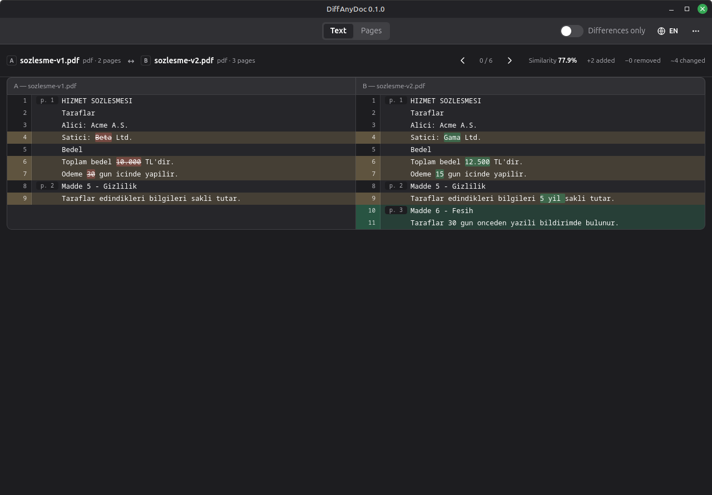
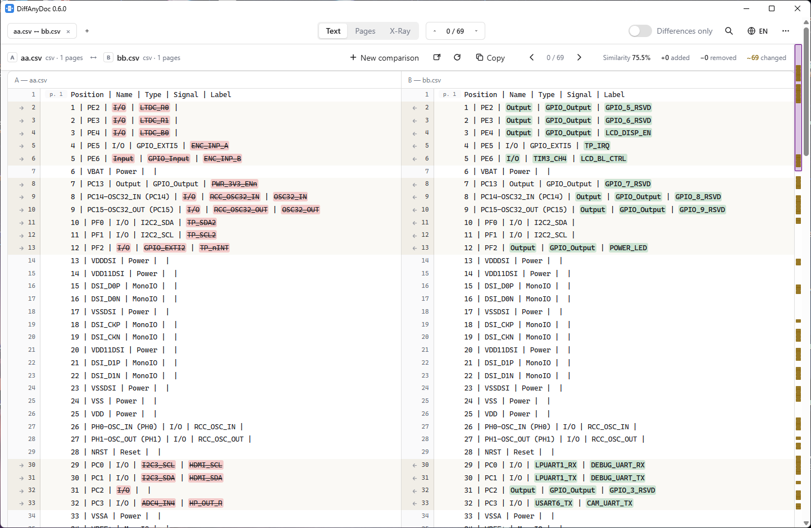
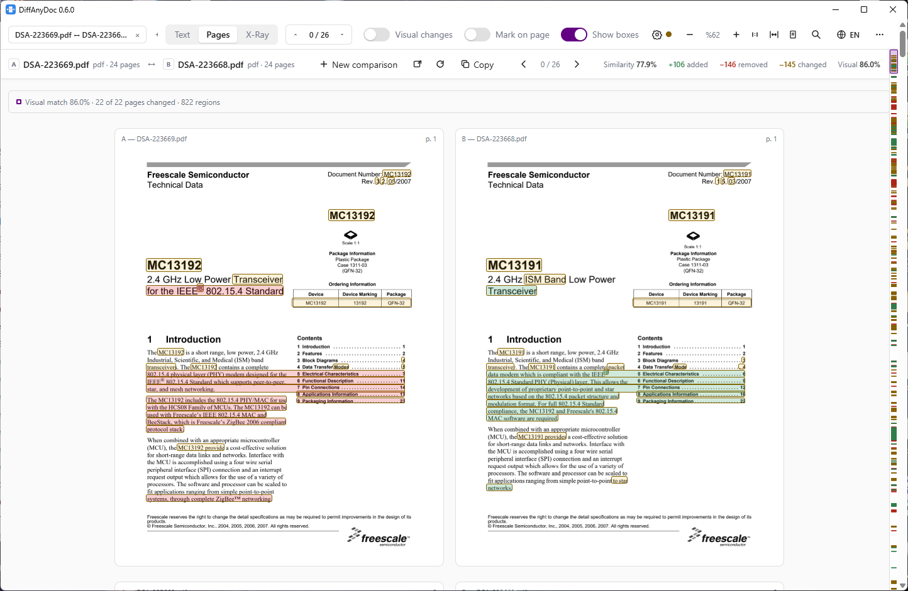
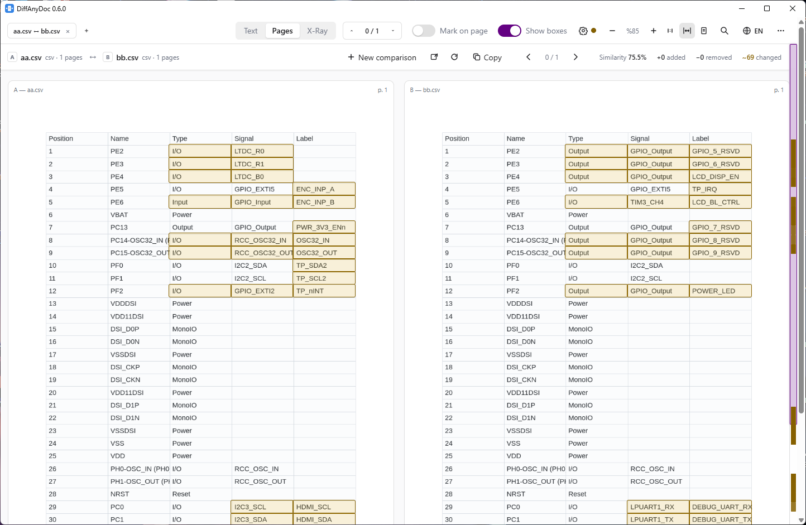
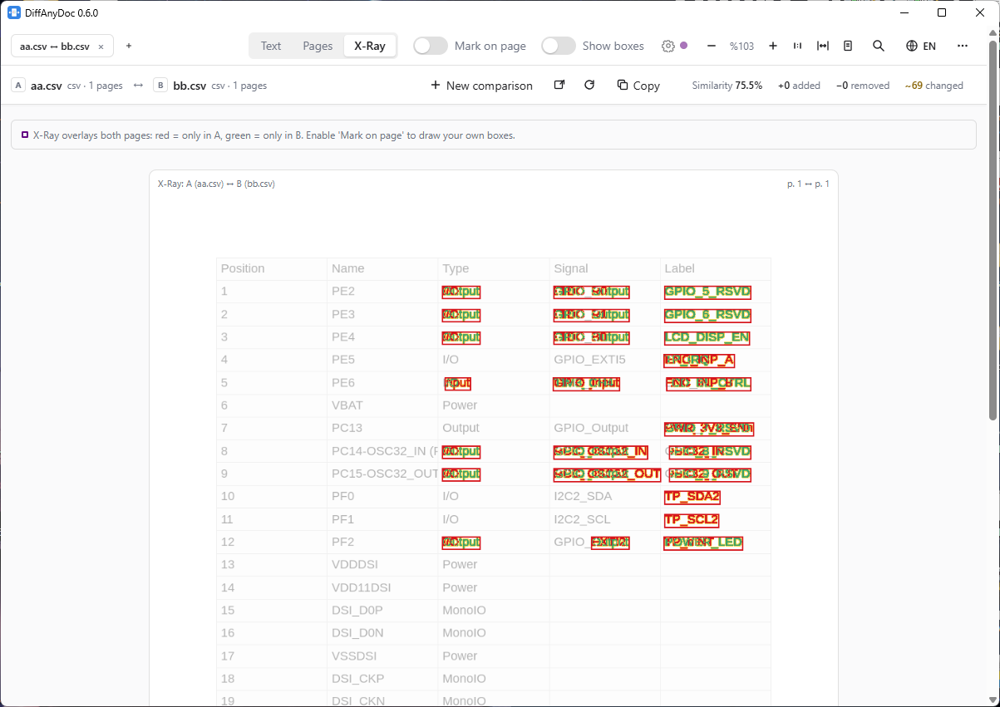
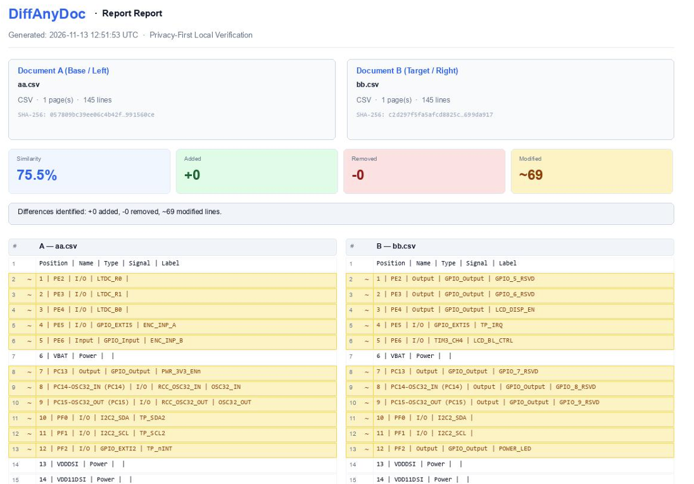

# DiffAnyDoc

Desktop app that compares documents side by side: PDF, DOCX, XLSX and plain text.
It shows text differences and marks changed lines with boxes on PDF pages.



## Features

- **Cross-Format Semantic Comparison**: PDF, DOCX, DOC/ODT/RTF, XLSX/XLSM, CSV/TSV, images (PNG/JPG/TIFF/WEBP/BMP), and plain text / source code
- **Fast SHA-256 Checksum & Preloading**: Byte-identical files short-circuit immediately; background preloading starts as soon as the first file is selected
- **Word-Level & Cell-Aware Diff**: Line alignment with word-level inline highlights, table row/cell matching, merged-cell expansion, and optional numeric tolerance
- **Page & Visual (Pixel) Diff**: Side-by-side rendered pages with pixel-registered bounding boxes, noise tolerance, and changed-region navigation
- **X-Ray Vision Overlay**: Pixel-registered composite overlay highlighting removed ink in red and added ink in green, plus interactive bounding-box annotations
- **Zero-Config Embedded OCR**: Automatic OCR for scanned/hybrid PDFs and images via **RapidOCR** (`rapidocr-onnxruntime`, Apache-2.0) with SHA-256 disk caching
- **Folder & Directory Comparison**: Recursive directory tree comparison with status filters and one-click file diff tabs
- **Interactive Merging & Reports**: Multi-tab sessions, side-to-side line/document merge (`A → B`, `B → A`), and offline HTML / printable PDF reports
- **Native Desktop & CLI**: Native desktop window (`pywebview` / GTK), file manager context menu integration, and `diff`, `info`, `formats`, `serve`, `desktop`, `select`, `integrate` commands

## Screenshots

### Text & Inline Diff View
Side-by-side text and cell-aware comparison with word-level inline highlights, per-line merge arrows (`→` / `←`), and a diff minimap scrollbar.



### Pages View (PDF & Tables)
Side-by-side rendered pages with customizable bounding boxes (`Show boxes`), visual match percentage, and changed region navigation.





### X-Ray Vision Overlay
Pixel-registered composite overlay highlighting removed content in red and added content in green.



### Offline Comparison Report
Self-contained HTML/PDF verification report with SHA-256 checksums, similarity summary cards, and side-by-side differences.



> **For AI Coding Agents (Claude Code, OpenCode, Cursor, etc.):** Read [`AGENTS.md`](AGENTS.md) and [`docs/DESIGN.md`](docs/DESIGN.md) before making changes.

English is the default for the app, CLI messages and reports. Turkish ships as a
second locale and can be selected in the app, or with `--lang tr` /
`DIFFANYDOC_LANG=tr`; the system locale is not used to pick a language.

## Installation

System dependencies (Linux, for the native window):

```bash
sudo apt install python3-gi gir1.2-webkit2-4.1 libgtk-3-0
# optional, for --ocr on scanned PDFs
sudo apt install tesseract-ocr tesseract-ocr-eng
```

Python side — the virtualenv must see system packages so it can load the GTK
bindings:

```bash
python3 -m venv --system-site-packages .venv
source .venv/bin/activate
pip install -e ".[dev,web,desktop]"
```

> `--system-site-packages` is only needed for the desktop shell on Linux;
> `PyGObject` cannot be built with pip, so the system `python3-gi` is used.
> Server and CLI usage do not need it.

> **Standalone builds.** `python tools/build.py` makes a PyInstaller bundle:
> a portable `.zip` and an Inno Setup installer on Windows (needs `ISCC`), a
> `.tar.gz` and an AppImage on Linux (needs `appimagetool`). Pushing a `v*` tag
> builds all of them plus the sdist/wheel in GitHub Actions. From a source
> checkout, `diffanydoc` is a console script inside the virtualenv.

## Usage

### Desktop

```bash
diffanydoc desktop                                # empty window
diffanydoc desktop old.pdf new.pdf                # compare on launch
diffanydoc desktop old.pdf new.pdf --debug        # webview developer tools
```

### App menu

The **⋯** button in the top right opens the overflow menu. Besides the
comparison actions (report, new comparison) it holds:

- **About DiffAnyDoc** — icon, version and a one-line summary
- **License Agreement** — the full license text in a scrollable dialog
- **Help** (`F1`) — quick start, views, merging, marks and keyboard shortcuts
- **Check for Updates** — asks GitHub for the latest release only when you open
  it, and shows release notes and a download link

These open as in-app modal dialogs rather than a classic menu bar; there is one
toolbar per window, matching the GNOME/libadwaita pattern.

### App icon

`tools/make_icon.py` generates the icon (one document between back/forward
arrows, with a red/green diff line) into SVG, PNG and ICO:

```bash
.venv/bin/python tools/make_icon.py
```

Output goes to `src/diffanydoc/web/static/icon.svg`, `icon.png`,
`icon-32.png` and `icon.ico`. The SVG is the favicon and in-app brand mark, the
PNG is the GTK window icon, and the ICO is used by the Windows build.

### File-manager integration (left/right context menu)

```bash
diffanydoc integrate install      # add "Select as left/right file" entries
diffanydoc integrate uninstall    # remove them
```

The entries hand the chosen file to the running window, or open one if needed:

1. Right-click a file → **Select as left file (DiffAnyDoc)**
2. Right-click another file → **Select as right file (DiffAnyDoc)**

The two files are compared automatically. On Windows this uses per-user registry
entries (no administrator rights); on Windows 11 the entries may appear under
**Show more options**. On Linux the installer writes Nautilus scripts, Nemo
(Cinnamon) actions and a Dolphin/KDE service menu, because there is no
cross-desktop context-menu API. Menu labels follow `--lang`, e.g.
`diffanydoc --lang tr integrate install`.

Restart the file manager once after installing or changing the language:

```bash
nautilus -q        # GNOME Files
nemo -q            # Cinnamon / Nemo, then open a folder again
```

If the entries use a virtualenv Python, keep that virtualenv where it is:
the generated commands point at `<venv>/bin/python`. Re-run
`diffanydoc integrate install` after moving the checkout or the environment.

### Browser (local server / on-prem team use)

```bash
diffanydoc serve --port 8765
# http://127.0.0.1:8765
```

Drop files on either box, or anywhere on the page: two files fill the left
and right side at once, one file goes to the first empty side. After a
comparison the toolbar keeps both files, so:

- **Reload** re-reads both files and re-runs the comparison. In the desktop
  window it picks up changes saved on disk; in a browser the original upload
  is resent, because a web page cannot read the file again.
- **Copy** copies all changes, the left text, the right text, or both sides
  side by side. Changed rows also get a small arrow next to the line number:
  `→` on the left copies that line for the right side, `←` on the right copies
  it for the left side (to the clipboard).

Whitespace-only edits are highlighted in blue instead of the red/green used for
real content changes.

### Command line

```bash
diffanydoc diff a.pdf b.pdf                       # summary in the terminal
diffanydoc diff a.pdf b.pdf --visual              # also compare rendered pixels
diffanydoc diff scan_a.pdf scan_b.pdf --ocr       # OCR pages without text
diffanydoc diff scan_a.pdf scan_b.pdf --ocr --ocr-lang tur+eng
diffanydoc diff a.pdf b.pdf -o report.html        # HTML report
diffanydoc diff a.txt b.txt --format json         # machine-readable output
diffanydoc diff a.pdf b.pdf --fail-on-diff        # exit code 1 when different
diffanydoc info document.pdf
diffanydoc formats
diffanydoc select left a.pdf                      # hand a file to the running window
```

`--fail-on-diff` is designed for CI:

```bash
git config diff.diffanydoc.command 'diffanydoc diff --fail-on-diff $2 $5'
```

## Architecture

```
file ──> [adapter] ──> Document IR ──> [diff engine] ──> DiffResult ──> CLI / HTML / API / UI
```

The one rule: **formats are converted into a shared model, not into each other.**
That way a PDF and a DOCX can be compared by the same engine; adding a format
means writing an adapter, not a new diff algorithm.

```
src/diffanydoc/
  core/
    model.py          # Document / Page / Block + DiffResult / Row
    normalize.py      # NFKC, typography, soft hyphen, whitespace normalisation
    adapters/         # base.py (registry), pdf.py, docx.py, xlsx.py, text.py,
                      # ooxml.py (shared ZIP/XML helpers, no third-party parser)
    diff/             # align.py (pages), lines.py (lines + inline), engine.py
    render.py         # pdfium page rasterisation (shared, cached, locked)
    ocr.py            # Tesseract fallback for scanned pages + on-disk cache
    visual.py         # pixel comparison, registration, region boxes
    report/           # html.py, json.py
  cli.py              # reference consumer of every feature
  web/                # FastAPI + build-free SPA
  desktop/            # pywebview shell (local API + native window)
```

The engine under `core/` knows nothing about Qt or HTTP, so the CLI, API and
desktop share the same code and the engine is tested separately.

### Diff layers

| Layer | Status | Note |
|---|---|---|
| Byte (sha256) | **done** | fast path for identical files (skips parsing) |
| Structure (docx/xlsx XML, table cells) | **done** | M3, stdlib `zipfile` + `ElementTree` + merged cells |
| Text (line + word) | **done** | M0 |
| Page mapping | **done** | LCS + similarity for leftover pages |
| Visual (pixel) | **done** | M2, opt-in in the engine, on by default in the UI (PDF + image) |
| OCR layer | **done** | M4, opt-in, scanned/hybrid PDFs and images |

The visual layer is enabled with `--visual` on the CLI, or by the API
(`"visual": true`, the default). It renders both PDFs at 96 dpi, searches a
±4 pt registration offset, ignores per-pixel differences below 24/255 and
reports changed regions in PDF points. It only runs when both files are PDFs;
`visual.stats` carries `similarity`, `changed_pages`, `changed_pixels` and the
region count, and `visual.pages` carries the boxes for each page.

The OCR layer is enabled with `--ocr` on the CLI, in the upload options of the
web UI, or with `"ocr": true` on the API. Pages whose extracted text is shorter
than 8 non-whitespace characters are rendered at 300 dpi and passed to the
`tesseract` binary; recognised words become normal text blocks with bounding
boxes, so the diff, the viewer rectangles and the HTML report all work the same
way. `--ocr-lang` selects Tesseract languages (default `eng`). Results are
cached per file hash, page, language, DPI and segmentation mode under the user
cache directory (`~/.cache/diffanydoc/ocr` on Linux,
`%LOCALAPPDATA%\DiffAnyDoc\cache\ocr` on Windows,
`~/Library/Caches/DiffAnyDoc/ocr` on macOS). `DIFFANYDOC_CACHE_DIR` changes the
base directory and `DIFFANYDOC_TESSERACT` points at a specific binary. If
Tesseract is missing, only comparisons that actually need OCR fail, with an
install hint.

## Licensing strategy

Because the target is a commercial release, dependencies were chosen from
**permissive** licences:

| Package | Licence | Use |
|---|---|---|
| `pdfplumber` / `pdfminer.six` | MIT | PDF text + coordinates |
| `pypdfium2` | Apache-2.0 / BSD-3 | PDF rendering |
| `Pillow` | MIT-CMU | images |
| `rapidocr-onnxruntime` | Apache-2.0 | Embedded ONNX OCR engine |
| `fastapi` / `uvicorn` | MIT / BSD-3 | API |
| `pywebview` | BSD-3 | desktop shell |
| GTK / WebKit2GTK | LGPL | system webview (dynamic linking) |

Deliberately **not used**: PyMuPDF (AGPL), PyQt6 (GPL), parts of reportlab.
These would require extra licensing for a closed-source commercial release.

> **License**: DiffAnyDoc is distributed under a proprietary Commercial End User License Agreement (EULA). All bundled third-party libraries use approved permissive open-source licenses (MIT, Apache-2.0, BSD-3, PSF). See [`LICENSE`](LICENSE), [`EULA.md`](EULA.md), and [`THIRD_PARTY_NOTICES.md`](THIRD_PARTY_NOTICES.md).

## Roadmap

- **M0 — engine + CLI** ✅ IR, PDF/text adapters, line + inline diff, HTML/JSON report
- **M1 — viewer** ✅ web UI + native window, change boxes on PDF pages
- **M2 — visual diff** ✅ page-render comparison, tolerance, registration
- **M3 — DOCX/XLSX** ✅ structural diff, table-cell alignment
- **M4 — OCR** ✅ fallback layer for scanned PDFs + cache
- **M5 — distribution** 🚧 PyInstaller builds (Windows zip + installer, Linux
  tar.gz + AppImage, PyPI) and the update check are in; the commercial licence
  and EULA are still open (`TODO.md` TASK-04)

## Tests

```bash
pytest
```

Test fixtures generate the documents at runtime (`tests/pdfgen.py`,
`tests/docxgen.py`, `tests/xlsxgen.py`); no binaries are kept in the repository.
Files under `samples/` are there for manual testing.

## Known limitations

- DOCX/XLSX are read without layout information: page breaks come from explicit
  breaks only, merged cells keep their top-left value, and comments, tracked
  change markup and embedded objects are ignored.
- Scanned PDFs need `--ocr` (or the UI checkbox) and a Tesseract installation.
  Without OCR they have no text to compare; the visual layer still reports which
  regions changed, but not what they say. OCR is only as good as the scan, and
  handwriting is not supported.
- Line-based alignment can be noisy when paragraphs are reflowed.
- Borderless (whitespace-aligned) PDF tables are read as lines of text; ruled PDF,
  DOCX and XLSX tables get full row and cell alignment.
